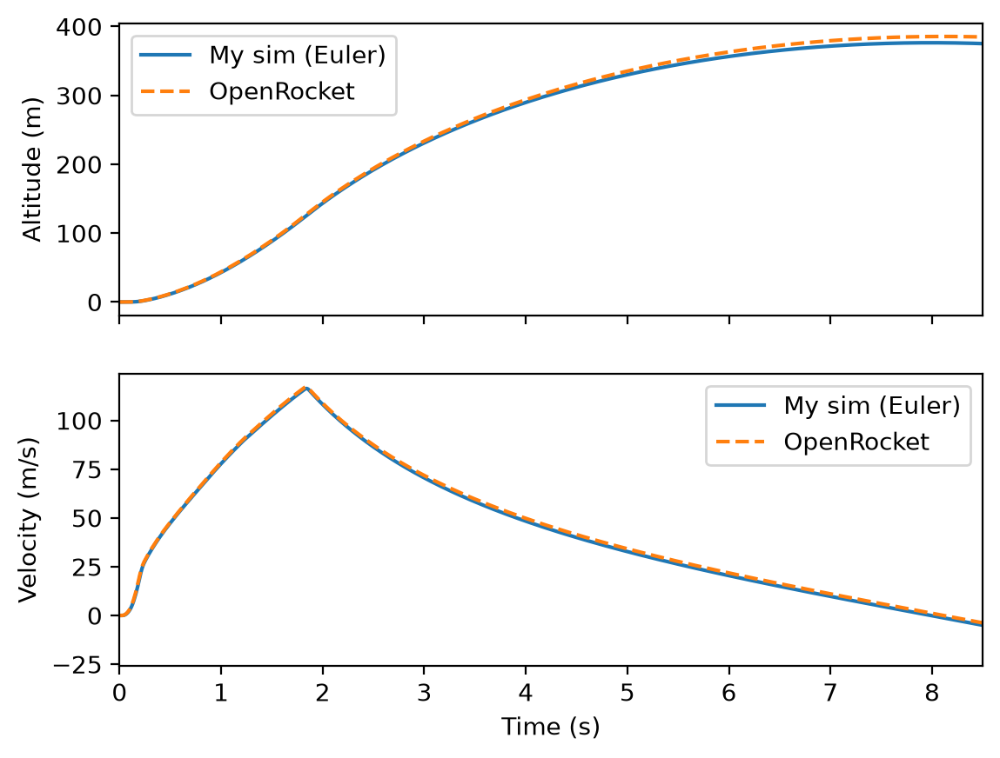
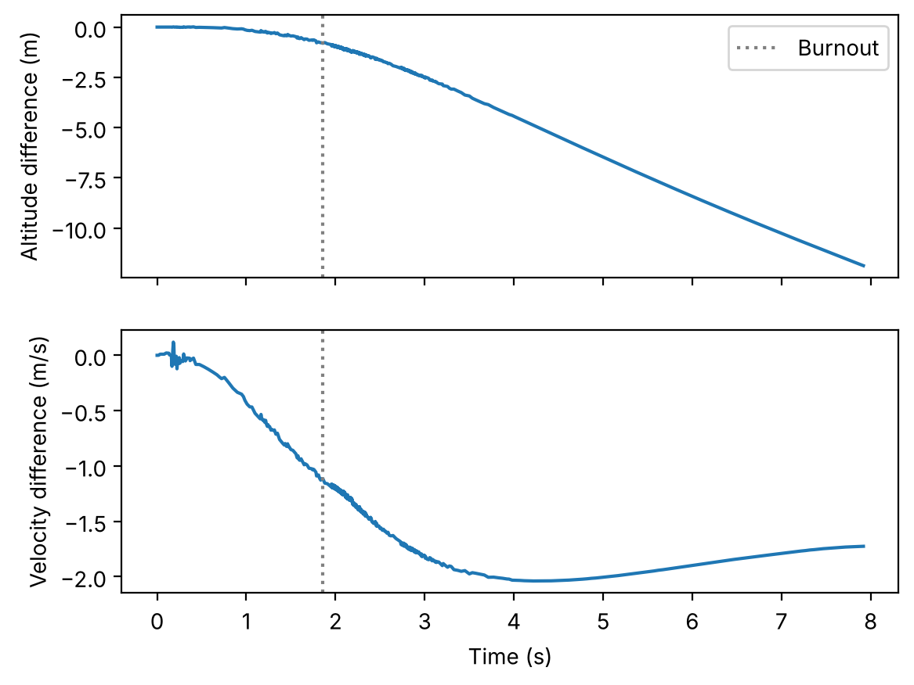
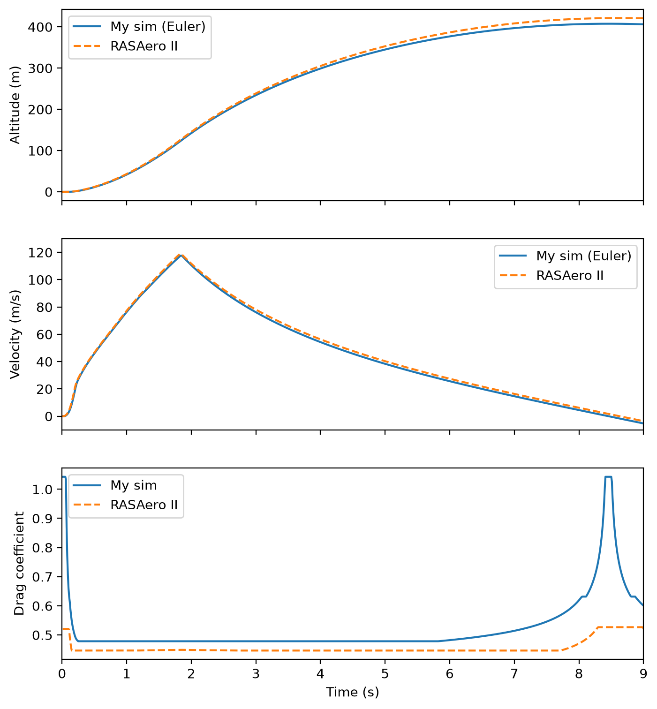
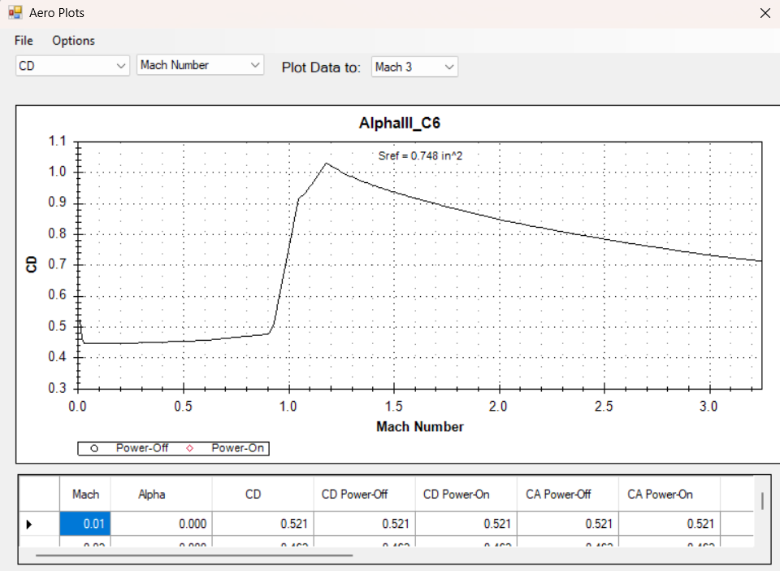

# 1D Model Rocket Flight Simulator

A 1D flight simulator for an Estes Alpha III model rocket on a C6-7 motor, built from first principles in Python. This project was inspired by my work experience at MBDA, which got me interested in how flight vehicles are simulated before they ever fly.

**v1** used a constant drag coefficient taken from OpenRocket and landed within 3.1% of OpenRocket's apogee.
**v2** builds the drag coefficient itself, component by component, using the method in MIL-HDBK-762 (*Design of Aerodynamically Stabilized Free Rockets*) plus a surface-roughness correction. With no drag data taken from any other program, the apogee lands **within 1.7% of OpenRocket and 3.1% of RASAero II**.

These are comparisons between simulations, not flight tests.



---

## The physics

The rocket is modelled as a point mass moving vertically, with upward taken as positive:

```math
m\frac{dv}{dt} = T(t) - mg - \tfrac{1}{2}\rho C_d A\, v|v|
```

where $T(t)$ is the measured thrust, $\rho$ is air density, $C_d$ is the drag coefficient and $A$ is the body's frontal area.

**Variable mass.** Applying conservation of momentum to the rocket and its exhaust gives

```math
m\frac{dv}{dt} = \dot{m}_e v_e - mg - D
```

so the thrust term is $T = \dot{m}_e v_e$.

$F = \frac{d(mv)}{dt}$ only holds for a system whose mass is constant, so it can't be applied to the rocket on its own: doing so adds an extra $v\,\dot{m}$ term whose size depends on the frame $v$ is measured in. The derivation therefore treats the rocket and its exhaust together as one closed system, and the thrust term $T = v_e\frac{dm_e}{dt}$ comes out of that momentum balance.

**Mass model.** Assuming constant exhaust velocity, $v_e = I_{total}/m_{prop}$, which gives

```math
m(t) = m_0 - m_{prop}\,\frac{I(t)}{I_{total}}, \qquad I(t) = \int_0^t T\,dt'
```

This means the mass at any time is the initial mass minus the propellant mass multiplied by the ratio of the impulse delivered so far to the total impulse.

**Drag direction.** Drag is written as $v|v|$ rather than $v^2$.

$v^2$ fixes the sign no matter what phase the rocket is in, as a square is always positive. Multiplying the velocity by its absolute value keeps its sign, so drag always opposes the motion whether the rocket is going up or coming down.

**Air density (ISA).** In the troposphere temperature falls linearly, $T = T_0 - Lh$. Combining hydrostatic balance $dp/dh = -\rho g$ with $p = \rho R T$ and integrating gives

```math
\rho = \rho_0\left(\frac{T}{T_0}\right)^{\frac{g}{RL}-1}
```

**Check:** with $g = 0$ and no drag, the equation of motion reduces to the Tsiolkovsky rocket equation,

```math
\Delta v = v_e \ln\left(\frac{m_0}{m_f}\right)
```

The full derivations are in my handwritten notes: [derivation_notes.pdf](derivation_notes.pdf).

---

## v2: Building the drag coefficient (MIL-HDBK-762)

Following MIL-HDBK-762(MI) §5-5, the zero-lift drag of a free rocket is the sum of its components, each converted to the same reference area $A_{ref}$ (the body's frontal area):

```math
C_D = C_{D,\text{friction}} + C_{D,\text{base}} + C_{D,\text{fin edges}} + C_{D,\text{wave}}
```

| Component | Method | $C_D$ at 117 m/s |
|---|---|---|
| Body skin friction | $1.15\,C_f\,A_{wet}/A_{ref}$ (×1.15 for a body of revolution, MIL-HDBK-762 §5-5.2) | 0.290 |
| Fin skin friction | $C_f\,A_{wet}/A_{ref}$ (flat plates, both faces of 3 fins) | 0.108 |
| Body base drag | Fig. 5-140, $M \approx 0.3$ (data scatter ±0.03) | 0.11 |
| Fin trailing edges | $C_p\,A_{edges}/A_{ref}$, with $C_p \approx 0.055$ for rounded edges* | 0.020 |
| Wave drag | ≈ 0 below $M \approx 0.8$ (§5-5.1); peak speed is $M = 0.34$ | 0 |
| **Total** | | **0.53** |

\*Fig. 5-153 only covers square trailing edges ($C_p \approx 0.45$, which would give 0.17). For rounded edges I used half the body base value, a convention borrowed from OpenRocket.

### Skin friction

Which friction formula applies depends on the Reynolds number $Re = vL/\nu$. For the body ($L = 0.307$ m) the flow is turbulent above about 24 m/s, so for most of the flight. The fins are short (mean chord 37.5 mm), so on its own their boundary layer stays laminar.

- **Laminar (Blasius):** $C_f = 1.328/\sqrt{Re}$
- **Turbulent with a laminar front section:** $C_f = 0.074/Re^{1/5} - A/Re$

I derived $A$ myself by subtracting the turbulent friction that the formula wrongly assumes over the laminar front of the plate and adding back the laminar friction:

```math
A = 0.074\,Re_{crit}^{4/5} - 1.328\,Re_{crit}^{1/2} = 1743 \quad (Re_{crit} = 5\times10^5)
```

At $Re = 2.46\times10^6$ this gives $C_f = 0.0032$, against about 0.0033 read off the handbook's Fig. 5-134.

### Surface roughness

My first build-up used smooth-wall friction and came out at $C_D \approx 0.34$, **36% below OpenRocket**. Almost all of the gap was friction. The handbook's friction data are for smooth surfaces, but the Alpha III is painted. Once the roughness is taller than the thin viscous sublayer next to the wall (about 15–50 µm at these speeds), the bumps add their own drag and $C_f$ stops depending on $Re$:

```math
C_{f,\text{rough}} = 0.032\left(\frac{\varepsilon}{L}\right)^{1/5}
```

With OpenRocket's "regular paint" ($\varepsilon = 60$ µm), $C_{f,\text{rough}} = 0.0058$, nearly double the smooth value. The code uses whichever is larger: $C_f = \max(C_{f,\text{smooth}}, C_{f,\text{rough}})$.

### Base drag and the motor

Air can't turn the sharp corner at the back of the rocket, so it leaves a low-pressure pocket behind the base: $D_{base} = (p_\infty - p_b)A_{base}$. While the motor burns, the exhaust fills the middle of that pocket and only a ring of base around the nozzle still feels the low pressure, so base drag should drop during the burn. This **is not modelled**: OpenRocket 24.12 doesn't model it either (its source code applies full base drag throughout), and the C6 nozzle exit diameter isn't published.

### What this changes

The v2 model is switched on with `use_drag_model = True`. With all v2 options on (ISA, 24.79 mm diameter, drag model) it predicts **392.0 m, +1.7%** against OpenRocket.

---

## Inputs

| Parameter | Value | Source |
|---|---|---|
| Motor | Estes C6-7 | [thrustcurve.org](https://www.thrustcurve.org) (certified test data) |
| Total impulse | 8.82 Ns | Thrust curve, trapezium rule |
| Launch mass $m_0$ | 57.1 g | 34 g rocket (Estes spec) + 23.1 g motor |
| Propellant mass $m_{prop}$ | 10.8 g | OpenRocket motor database |
| Dry mass (after burnout) | 46.3 g | 34 g rocket + 12.3 g empty casing |
| Body diameter | 25 mm (v1) / 24.79 mm (v2, `use_or_diameter`) | Estes spec / BT-50 tube in the OpenRocket design |
| Drag coefficient | 0.56 constant (v1) / built up from components (v2) | OpenRocket / MIL-HDBK-762 |
| Surface roughness $\varepsilon$ | 60 µm | OpenRocket "regular paint" (Hoerner, *Fluid-Dynamic Drag*); an assumption, not measured |
| Air density | 1.225 kg/m³ constant (v1) / ISA (v2, `use_isa`) | — |
| Kinematic viscosity | $\nu = \mu/\rho$, $\mu = 1.789\times10^{-5}$ Pa·s | ISA sea level |
| Time step $\Delta t$ (Euler) | 0.01 s | — |

Conditions: no wind, vertical launch, sea level.

---

## Numerical methods

The state vector and its derivatives are

```math
\mathbf{y} = \begin{pmatrix} h \\ v \\ m \end{pmatrix}, \qquad
\frac{d\mathbf{y}}{dt} = \begin{pmatrix} v \\ \dfrac{T - mg - \tfrac{1}{2}\rho C_d A\, v|v|}{m} \\ -\dfrac{m_{prop}}{I_{total}}\,T \end{pmatrix}
```

Both solvers call the same derivative function, so any difference between them is purely numerical. In v2, $\rho$ and $C_d$ are recalculated inside that function at every step.

- **Euler (first order):** $\mathbf{y}_{n+1} = \mathbf{y}_n + \Delta t\,\mathbf{f}(t_n, \mathbf{y}_n)$
- **RK45:** SciPy's `solve_ivp` (Dormand–Prince, adaptive step), with `max_step = 0.01` s so it can't step over the thrust spike or burnout.
- **Thrust** between data points is found by linear interpolation.
- **Launch pad:** acceleration is held at zero while thrust < weight, so the rocket can't sink into the ground.
- **Apogee** is detected with an event function that finds where $v$ crosses zero.

The apogee event (which watches for $v$ crossing zero) fired at $t = 0$, because the rocket sits at exactly $v = 0$ on the pad until thrust exceeds its weight, which the solver counted as a crossing. I fixed this by only arming the event once the rocket is above 1 m.

In v2, the laminar formula $1.328/\sqrt{Re}$ divides by zero when the rocket is still on the pad, giving $C_d = \infty$ and a `nan` drag force ($\infty \times 0$). The Reynolds number is clamped to at least $10^4$ (about 0.5 m/s), where drag is negligible anyway.

---

## Verification: am I solving the equations correctly?

| Check | Result |
|---|---|
| Total impulse (trapezium rule) vs motor spec | 8.817 vs 8.8 Ns (0.2%) |
| Specific impulse $I_{total}/(m_{prop}\,g)$ from mass model vs spec | 83.2 vs ~83 s |
| Mass at burnout vs expected dry mass | 46.3 g vs 46.3 g (true by construction, so this only checks the mass integration) |
| Python Euler vs Excel Euler (same method, built independently) | 373.104 m vs 373.104 m |
| Euler ($\Delta t = 0.01$ s) vs RK45 | 373.10 vs 373.45 m (−0.09%) |
| v2 $C_f$ function vs hand calculation | 0.00319 (smooth, turbulent), 0.00242 (laminar), 0.0058 (rough): all match |
| v2 total $C_d$ at 117 m/s vs hand calculation | 0.522 vs 0.522 (25 mm diameter) |

The Euler/RK45 agreement shows the time step is small enough that the numerical error is negligible (about 0.1%), so any gap to OpenRocket comes from the model's inputs and physics rather than the solver.

---

## Comparison with OpenRocket

| Source | Apogee | vs OpenRocket |
|---|---|---|
| OpenRocket 24.12 | 385.5 m | — |
| v1: constant $C_d$ = 0.56 (RK45) | 373.4 m | −3.1% |
| v1 + ISA air density | 376.8 m | −2.3% |
| v1 + ISA + OpenRocket's body diameter | 380.2 m | −1.4% |
| **v2: drag build-up + ISA + OpenRocket's diameter** | **392.0 m** | **+1.7%** |
| v2 with v1's density and diameter | 387.7 m | +0.6% |
| Estes (manufacturer) | 351 m | −9.0% |

The +0.6% row looks better but is less honest: constant sea-level density and the oversized 25 mm diameter both add drag, which happens to cancel the v2 model being slightly low on drag. The +1.7% with the correct atmosphere and diameter is the real result.

| v2 (all options on) | This sim | OpenRocket | Difference |
|---|---|---|---|
| Max velocity | 118.2 m/s | 117 m/s | +1.0% |
| Time to apogee | 8.18 s | 8.12 s | +0.7% |

**Where the remaining +1.7% comes from.** Comparing my $C_d$ against the effective $C_d$ worked backwards from OpenRocket's trajectory (`openrocket_effective_cd.py`):

| Speed (m/s) | 21.8 | 34.2 | 71.8 | 98.8 | 108.8 |
|---|---|---|---|---|---|
| OpenRocket (effective) | 0.533 | 0.533 | 0.541 | 0.551 | 0.559 |
| This sim (v2) | 0.529 | 0.529 | 0.529 | 0.529 | 0.529 |

Mine is flat, because rough-wall friction and my base drag don't depend on speed, whereas OpenRocket's rises with speed. That is where the remaining +1.7% comes from: my model has slightly less drag than OpenRocket's when the rocket is fastest. OpenRocket's base drag formula increases with Mach number, so that is the likely cause, but I haven't investigated it further.

The residual plot below is from v1:



---

## Comparison with RASAero II

RASAero II (v1.0.2.0) is an aerodynamic prediction and flight simulation program calibrated against NACA/NASA wind tunnel and flight data. Unlike OpenRocket, it predicts power-on and power-off drag separately.

**Setup.** The OpenRocket design was exported to RockSim format and imported into RASAero, then every dimension was checked by hand. The import changed the fins from rounded to square, which I corrected (square trailing edges would have added about 0.15 to $C_d$). Launch conditions were set to match: sea level, 59 °F (ISA 15 °C), no wind, 1 m rail, vertical, built-in Estes C6 motor.

Two things couldn't be matched exactly:
- **Roughness:** RASAero offers fixed finishes. The closest to 60 µm is "Rough Camouflage Paint" (0.0012 in = 30.5 µm), so for this comparison I re-ran my sim with `eps = 30.5e-6`.
- **Mass:** RASAero only takes weight to 0.01 lb. I ran 0.12 lb and 0.13 lb and interpolated linearly to 57.1 g (0.1259 lb).

| Same inputs (30.5 µm, ISA, 24.79 mm, 57.1 g) | $C_d$ at $M = 0.3$ | Max velocity | Apogee |
|---|---|---|---|
| This sim (v2) | 0.478 | 120.6 m/s | 413.2 m |
| RASAero II | 0.448 | 122.1 m/s | 426.6 m |
| Difference | +6.7% | −1.2% | **−3.1%** |

Max velocities agree to about 1%, so the motor data and the burn phase match well. The apogee gap comes mostly from the coast, where RASAero predicts about 6% less drag than my build-up. Both programs also put the centre of pressure in the same place (OpenRocket 9.88 in, RASAero 9.85 in from the nose), which confirms the imported geometry.

**Direct run.** For a second, uninterpolated check I exported RASAero's 0.13 lb (59.0 g) trajectory and ran my sim with the same mass and roughness (`m0 = 0.0590`, `eps = 30.5e-6`): **407.8 m vs 421.2 m (−3.2%)**.



The drag coefficient panel shows where the gap comes from. While the rocket is fast, both models are flat, with mine about 0.03 higher, and that offset accounts for the apogee difference. Both models also show $C_d$ rising at low speed, at launch and near apogee, because skin friction gets larger at low Reynolds number. In my model this starts below about 27 m/s, when the fins' Reynolds number is low enough for laminar friction to exceed rough-wall friction, and it peaks at the $Re = 10^4$ clamp near apogee. RASAero shows the same effect, much more gently. Drag scales with $v^2$, so these low-speed rises have almost no effect on the trajectory.



RASAero's $C_d$ is flat across my speed range and only rises sharply above about Mach 0.9, where wave drag starts. That backs up leaving wave drag out below Mach 0.8. Its power-on and power-off curves are identical here because the nozzle exit diameter was set to zero (unknown).

**Summary:**

| Model | Roughness | $C_d$ near $M = 0.3$ | Apogee |
|---|---|---|---|
| OpenRocket 24.12 | 60 µm | ≈ 0.55 (effective) | 385.5 m |
| This sim (v2) | 60 µm | 0.53 | 392.0 m |
| This sim (v2) | 30.5 µm | 0.48 | 413.2 m |
| RASAero II | 30.5 µm | 0.45 | 426.6 m |

At matching roughness, my drag build-up sits between the two programs: about 0.02 below OpenRocket's and 0.03 above RASAero's.

---

## Key findings

- **Surface finish matters more than anything else in the drag model.** Going from 60 µm to 30.5 µm roughness changes the apogee by about 21 m (5%); smooth-wall friction would have under-predicted drag by a third.
- **Fin edge shape is the next biggest choice:** square rather than rounded trailing edges would add about 0.15 to $C_d$. In OpenRocket, the same change raised $C_d$ from 0.56 to 1.08.
- Changing $C_d$ by 0.03 moves the apogee by about 11 m (3%).
- Apogee changes by about 2 m per gram of launch mass.
- The peak thrust-to-weight ratio was about 25:1, and at top speed drag was about 5 times the rocket's weight.

---

## Limitations

- **Empirical inputs:** base drag (±0.03), roughness (60 µm assumed, not measured), the rounded-fin-edge factor (borrowed from OpenRocket) and the transition Reynolds number ($5\times10^5$) all come from data or conventions, not first principles.
- **$C_d$ doesn't vary with speed** at high speed, unlike OpenRocket's, which is the likely source of the remaining gap.
- **No power-on base drag reduction**, as explained above.
- **Nose treated as a cone** when working out its wetted area (it is really a tangent ogive), a few per cent on a small area.
- **1D only:** no wind, no weathercocking, no launch rod. (The rocket's static margin is 2.05 calibres, so it stays pointed into the airflow.)
- **Constant exhaust velocity** assumed in the mass model.
- **No parachute:** after apogee the sim falls ballistically, so only the ascent is compared.
- **Simulation-to-simulation only:** proper validation needs flight data.

---

## Next steps

- Power-on base drag (needs the C6 nozzle exit diameter)
- Investigate how drag should vary with speed (Mach number) at high speed
- Uncertainty analysis on roughness, base drag, mass and motor impulse
- Compare with real flight data from a logging altimeter
- Parachute descent and landing speed
- 2D trajectory with wind

---

## Use of AI

The derivations and the maths are my own and are in `derivation_notes.pdf`. I had AI help with Python syntax and with structuring the script.

For v1, the breakdown of the gap to OpenRocket (air density, body diameter and effective drag coefficient) and corrections to this README were done with an AI assistant; they are in the commit history.

For v2, an AI assistant pointed me to the relevant sections of MIL-HDBK-762 and explained the physics step by step. I worked through the derivations myself (the laminar-front correction, base drag and the fin-edge coefficient) and wrote the code. The AI read OpenRocket's source code to find its roughness and base-drag models, computed OpenRocket's component breakdown, helped set up the RASAero II comparison, and drafted the v2 sections of this README, which I checked against my own results.

## References

- MIL-HDBK-762(MI), *Design of Aerodynamically Stabilized Free Rockets*, US Army Missile Command, §5-5 (drag)
- H. Schlichting, *Boundary-Layer Theory* (Blasius, Prandtl, rough-wall friction, viscous sublayer)
- S. F. Hoerner, *Fluid-Dynamic Drag* (surface roughness values)
- [OpenRocket](https://github.com/openrocket/openrocket) 24.12 source code and technical documentation
- C. Rogers and D. Cooper, *RASAero II Users Manual* (surface finish roughness table)

## Running it

```bash
pip install -r requirements.txt
python rocket_sim.py
python openrocket_effective_cd.py
```

The model is controlled by switches at the top of `rocket_sim.py`:

| Switch | False | True |
|---|---|---|
| `use_isa` | constant 1.225 kg/m³ | ISA density |
| `use_or_diameter` | 25 mm | 24.79 mm (OpenRocket's BT-50) |
| `use_drag_model` | constant $C_d$ = 0.56 | v2 drag build-up |

All `False` reproduces v1 and the Excel verification (373.4 m). All `True` is the full v2 model (392.0 m). Set `eps = 30.5e-6` for the RASAero comparison (413.2 m). To reproduce `validation_vs_rasaero.png`, set `compare_rasaero = True`, `eps = 30.5e-6` and `m0 = 0.0590` (407.8 m).

| File | Contents |
|---|---|
| `rocket_sim.py` | Simulation, drag model, solvers and plots |
| `Estes_C6.csv` | Certified C6 thrust curve (thrustcurve.org) |
| `openrocket_effective_cd.py` | Works out the drag coefficient OpenRocket was effectively using |
| `openrocket_C6-7.csv` | OpenRocket export used for the comparison |
| `AlphaIII_C6.ork` | OpenRocket design file the export came from |
| `AlphaIII_C6.CDX1` | RASAero II design file |
| `validation_vs_openrocket.png` | Comparison plot (v2, all options on) |
| `residuals_vs_openrocket.png` | Difference between this simulator (v1) and OpenRocket against time |
| `rasaero_flight_013lb.csv` | RASAero II trajectory export (0.13 lb run) |
| `validation_vs_rasaero.png` | Altitude, velocity and drag coefficient vs RASAero II |
| `rasaero_cd_vs_mach.png` | RASAero II drag coefficient against Mach number |
| `derivation_notes.pdf` | Handwritten derivations |
| `excel_verification.xlsx` | Hand verification: impulse, mass model, coast estimate and Excel Euler |
