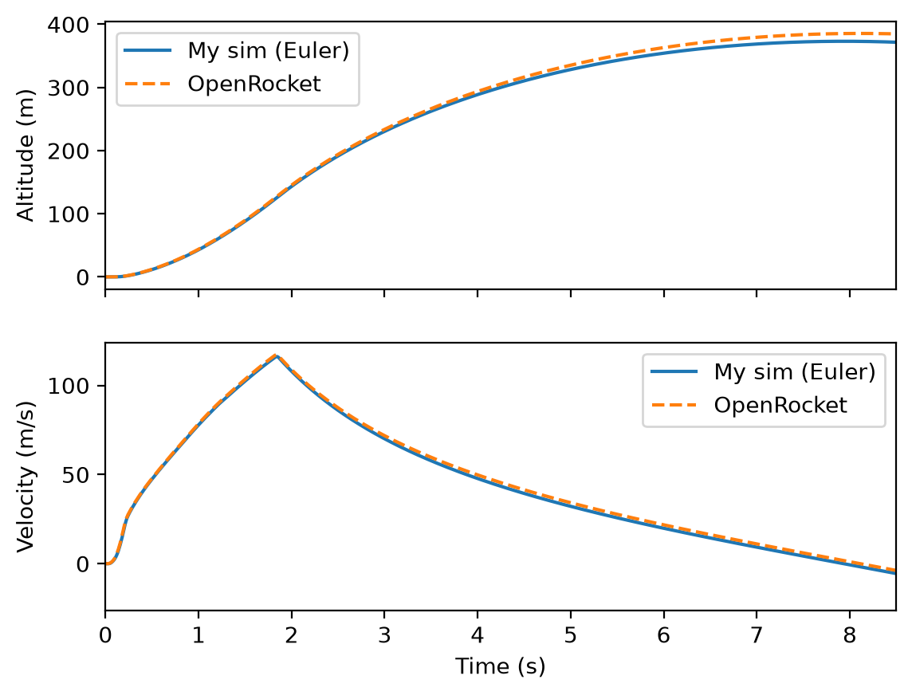

# 1D Model Rocket Flight Simulator

A 1D flight simulator for an Estes Alpha III model rocket on a C6-7 motor, built from first principles in Python. It models altitude, velocity and apogee, and is validated against OpenRocket to within 3.1%. This project was inspired by seeing a Storm Shadow in person at MBDA, which got me interested in how flight vehicles are simulated before they fly.



---

## The physics

The rocket is modelled as a point mass moving vertically, with upward taken as positive:

```math
m\frac{dv}{dt} = T(t) - mg - \tfrac{1}{2}\rho C_d A\, v|v|
```

where $T(t)$ is the measured thrust, $\rho$ is air density, $C_d$ is the drag coefficient and $A$ is the body's frontal area.

**Variable mass.** Applying conservation of momentum to the rocket and its exhaust gives

```math
m\frac{dv}{dt} = \dot{m}_e v_e - mg - D
```

so the thrust term is $T = \dot{m}_e v_e$.

> ✏️ **YOUR WORDS (1–2 sentences):** why the equation uses $m\frac{dv}{dt}$ and not $\frac{d(mv)}{dt}$, i.e. the exhaust momentum is already inside the measured thrust.

**Mass model.** Assuming constant exhaust velocity, $v_e = I_{total}/m_{prop}$, which gives

```math
m(t) = m_0 - m_{prop}\,\frac{I(t)}{I_{total}}, \qquad I(t) = \int_0^t T\,dt'
```

> ✏️ **YOUR WORDS (1 sentence):** what this means physically, i.e. mass is lost in proportion to impulse delivered, so fastest during the thrust spike.

**Drag direction.** Drag is written as $v|v|$ rather than $v^2$.

> ✏️ **YOUR WORDS (1 sentence):** why, i.e. $v^2$ loses the sign of $v$, while $v|v|$ always opposes motion.

**Check:** with $g = 0$ and no drag, the equation reduces to the Tsiolkovsky rocket equation,

```math
\Delta v = v_e \ln\left(\frac{m_0}{m_f}\right)
```

The full derivation is in my handwritten notes *(✏️ optional: link a PDF scan here)*.

---

## Inputs

| Parameter | Value | Source |
|---|---|---|
| Motor | Estes C6-7 | [thrustcurve.org](https://www.thrustcurve.org) (certified test data) |
| Total impulse | 8.82 Ns | Thrust curve, trapezium rule |
| Launch mass $m_0$ | 57.1 g | 34 g rocket (Estes spec) + 23.1 g motor |
| Propellant mass $m_{prop}$ | 10.8 g | OpenRocket motor database |
| Dry mass (after burnout) | 46.3 g | 34 g rocket + 12.3 g empty casing |
| Body diameter | 25 mm ($A = 4.91 \times 10^{-4}$ m²) | Estes spec |
| Drag coefficient $C_d$ | 0.56 | OpenRocket (rounded 1.5 mm fins) |
| Air density $\rho$ | 1.225 kg/m³ | Sea level, held constant |
| Time step $\Delta t$ (Euler) | 0.01 s | — |

Conditions: no wind, vertical launch, sea level.

---

## Numerical methods

The state vector and its derivatives are

```math
\mathbf{y} = \begin{pmatrix} h \\ v \\ m \end{pmatrix}, \qquad
\frac{d\mathbf{y}}{dt} = \begin{pmatrix} v \\ \dfrac{T - mg - \tfrac{1}{2}\rho C_d A\, v|v|}{m} \\ -\dfrac{m_{prop}}{I_{total}}\,T \end{pmatrix}
```

Both solvers call the same derivative function, so any difference between them is purely numerical.

- **Euler (first order):** $\mathbf{y}_{n+1} = \mathbf{y}_n + \Delta t\,\mathbf{f}(t_n, \mathbf{y}_n)$
- **RK45:** SciPy's `solve_ivp` (Dormand–Prince, adaptive step), with `max_step = 0.01` s so it can't step over the thrust spike or burnout.
- **Thrust** between data points is found by linear interpolation.
- **Launch pad:** acceleration is held at zero while thrust < weight, so the rocket can't sink into the ground.
- **Apogee** is detected with an event function that finds where $v$ crosses zero.

> ✏️ **YOUR WORDS (1–2 sentences):** the lift-off trap, i.e. the event first fired at $t = 0$ because $v$ sits at exactly 0 on the pad, fixed by only arming it above 1 m.

---

## Verification: am I solving the equations correctly?

| Check | Result |
|---|---|
| Total impulse (trapezium rule) vs motor spec | 8.817 vs 8.8 Ns (0.2%) |
| Exhaust velocity $I_{sp}$ from mass model vs spec | 81.7 vs ~83 s |
| Mass at burnout vs expected dry mass | 46.3 g vs 46.3 g |
| Python Euler vs Excel Euler (same method, built independently) | 373.104 m vs 373.104 m |
| Euler ($\Delta t = 0.01$ s) vs RK45 | 373.10 vs 373.45 m (−0.09%) |

> ✏️ **YOUR WORDS (1–2 sentences):** what the Euler vs RK45 result means, i.e. numerical error is ~0.1%, so the gap to OpenRocket must come from the physics, not the solver.

---

## Validation: am I solving the right equations?

| Source | Apogee | vs OpenRocket |
|---|---|---|
| OpenRocket 24.12 | 385.5 m | — |
| **This simulator (RK45)** | **373.4 m** | **−3.1%** |
| This simulator (Euler) | 373.1 m | −3.2% |
| Analytical coast solution* | 378 m | −2.1% |
| Estes (manufacturer) | 351 m | −9.0% |

\*Exact coast-phase solution using OpenRocket's burnout state ($v_b = 117$ m/s, $h_b = 130$ m):

```math
\Delta h = \frac{m}{2k}\ln\left(1 + \frac{k v_b^2}{mg}\right), \qquad k = \tfrac{1}{2}\rho C_d A
```

| | This sim | OpenRocket | Difference |
|---|---|---|---|
| Max velocity | 116.2 m/s | 117 m/s | −0.7% |
| Time to apogee | 7.94 s | 8.12 s | −2.2% |

> ✏️ **YOUR WORDS (2–3 sentences):** where the gap comes from. Point to the plot: the curves match through the burn and only separate in the coast. Constant sea-level $\rho$ overestimates drag at altitude; re-running the coast formula with $\rho$ at 250 m closed the gap from 2.1% to 1.2%. Predicted *before* seeing the result.

---

## Key findings

> ✏️ **YOUR WORDS, 2–4 bullets.** Suggestions:
> - Fin geometry alone (square 3 mm → rounded 1.5 mm) changed $C_d$ from 1.08 to 0.56 and OpenRocket's apogee from 265 m to 379 m (+43%). $C_d$ is the least certain input.
> - The prediction that Euler would overestimate apogee was wrong: it underestimated, because it applies drag at the start of each step (when speed is highest), over-decelerating the rocket.
> - At this rocket's size, peak drag is ~6× its weight, so drag dominates the coast.
> - Peak thrust-to-weight is ~25:1, which gets the rocket off the rod at ~20 m/s.

---

## Limitations

- **Constant air density.** No altitude variation (OpenRocket uses the International Standard Atmosphere).
- **Constant $C_d$**, taken from OpenRocket, so the comparison isn't fully independent: it validates the equations of motion and integration, not the aerodynamics.
- **1D only:** no wind, no weathercocking, no launch rod.
- **Constant exhaust velocity** assumed in the mass model.
- **No parachute:** after apogee the sim falls ballistically, so only the ascent is compared.

> ✏️ **Optional:** add anything else you think matters.

---

## Next steps

- Parachute descent and landing speed
- Sensitivity analysis on $C_d$ and mass
- Altitude-dependent air density (ISA)
- 2D trajectory with wind
- Compare with real flight data from a logging altimeter

---

## Running it

```bash
pip install numpy scipy matplotlib
python thrust.py
```

| File                           | Contents |
|--------------------------------|---|
| `rocket_sim.py`                | Simulation, solvers and plots |
| `Estes_C6.csv`                 | Certified C6 thrust curve (thrustcurve.org) |
| `openrocket_C6-7.csv`          | OpenRocket export used for validation |
| `validation_vs_openrocket.png` | Comparison plot |
